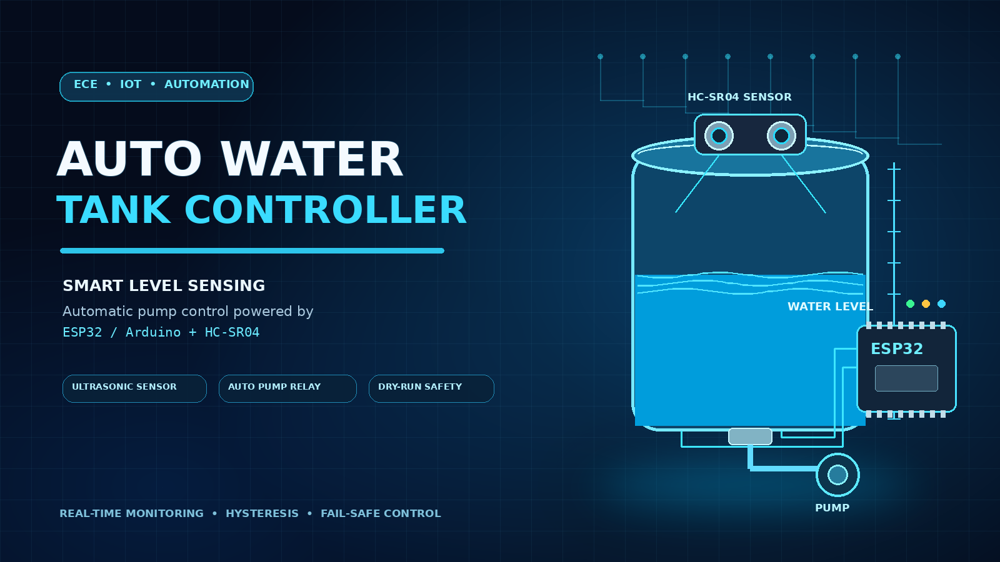
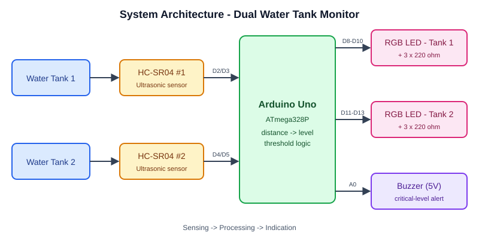
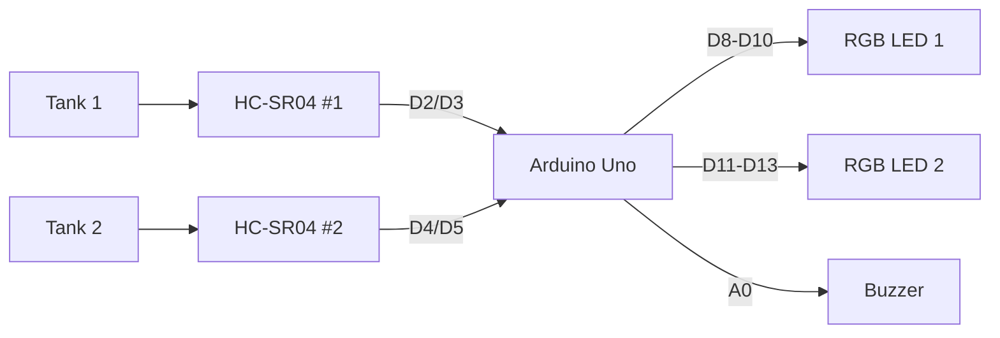
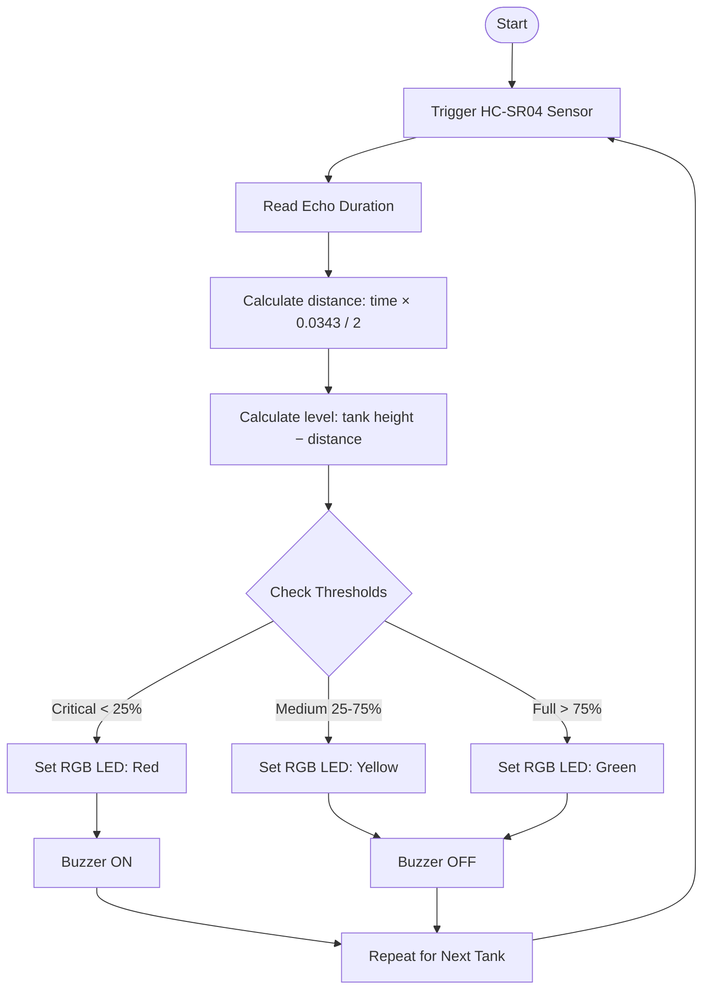
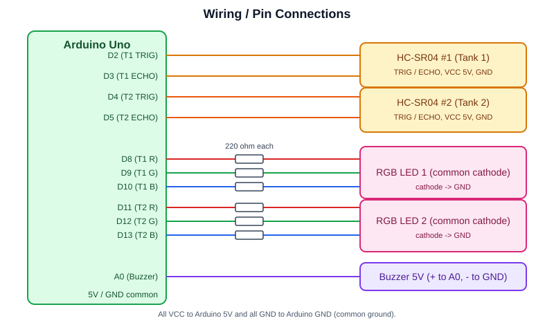
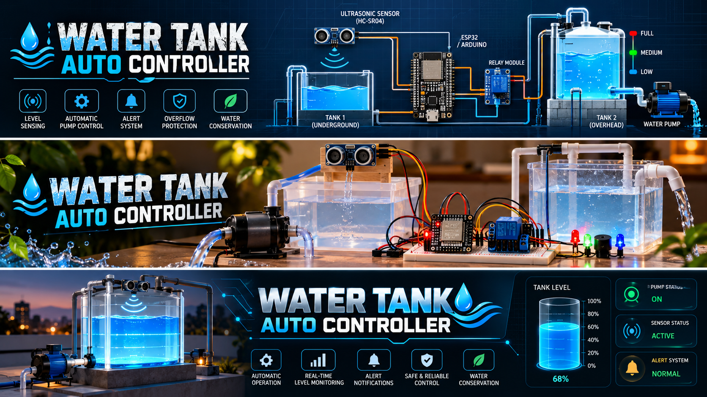

# 💧 Dual Water Tank Level Monitoring System



Arduino Uno based system that monitors the water level of two tanks using ultrasonic sensors, and displays real-time status through RGB LEDs and a buzzer alert.

> **B.Tech ECE Mini-Project**, TGPCET (RTMNU), Session 2026-27

---

## ✨ Features
- **Independent Monitoring**: Tracks two separate water tanks simultaneously in real time.
- **Non-Contact Ultrasonic Sensing**: Uses two HC-SR04 sensors to measure distance without submerged probes.
- **RGB LED Visual Indicators**: Dedicated common-cathode RGB LED for each tank showing Low (🔴 Red), Medium (🟡 Yellow), and High (🟢 Green).
- **Audible Warning**: Automatic buzzer alert when any tank drops below the critical threshold (< 25%).
- **Digital Filtering**: Median filtering over multiple samples to eliminate acoustic echo noise and surface ripples.
- **Low Cost & Expandable**: Simple hardware with minimal components, easily deployed for residential, agricultural, or industrial tanks.

---

## 🏗️ Architecture

The system operates across three distinct stages: **Sensing** (2 × HC-SR04 ultrasonic sensors), **Processing** (Arduino Uno microcontroller), and **Indication** (2 × RGB LEDs + 5V buzzer).





### Program Flow


---

## 🧰 Components

| Component | Qty | Specification / Function |
|---|---|---|
| **Arduino Uno** | 1 | ATmega328P Microcontroller Board |
| **HC-SR04 Ultrasonic Sensor** | 2 | 2cm – 400cm Non-Contact Distance Sensor |
| **RGB LED** | 2 | Common-Cathode 5mm RGB LEDs |
| **Resistors** | 6 | 220 Ω Current-Limiting Resistors for RGB LEDs |
| **5V Active Buzzer** | 1 | Audible Warning Alarm |
| **Breadboard & Jumper Wires** | – | Prototype Connections & Common 5V/GND Rails |

---

## 🔌 Pin Connections



| Device | Signal | Arduino Uno Pin | Description |
|---|---|---|---|
| **Tank 1 Sensor** | TRIG | **D2** | Trigger pulse output |
| **Tank 1 Sensor** | ECHO | **D3** | Echo return pulse input |
| **Tank 2 Sensor** | TRIG | **D4** | Trigger pulse output |
| **Tank 2 Sensor** | ECHO | **D5** | Echo return pulse input |
| **Tank 1 RGB LED** | R / G / B | **D8, D9, D10** | Red, Green, Blue cathodes via 220Ω |
| **Tank 2 RGB LED** | R / G / B | **D11, D12, D13** | Red, Green, Blue cathodes via 220Ω |
| **Buzzer** | Signal (+) | **A0** | 5V Active Buzzer trigger |
| **Power Rails** | VCC / GND | **5V / GND** | Common power across sensors and indicators |

---

## ⚙️ How It Works

1. **Ultrasonic Ping**: The HC-SR04 sends an 8-cycle ultrasonic burst (40 kHz) and measures the duration until the reflected echo is received.
2. **Distance Conversion**: Arduino calculates distance to water surface:
   $$\text{Distance (cm)} = \frac{\text{Echo Time } (\mu\text{s}) \times 0.0343}{2}$$
3. **Level Calculation**:
   $$\text{Water Depth} = \text{Tank Height} - \text{Distance}$$
   $$\text{Fill Percentage (\%)} = \left(\frac{\text{Water Depth}}{\text{Effective Height}}\right) \times 100$$
4. **Visual & Audio Indication**:

| Level Status | Water Capacity | RGB LED Color | Buzzer Alarm |
|---|---|---|---|
| **Critical / Low** | $< 25\%$ | 🔴 **Red** | **ON** (Beeping Warning) |
| **Normal / Moderate** | $25\% - 75\%$ | 🟡 **Yellow** | **OFF** |
| **Full / High** | $> 75\%$ | 🟢 **Green** | **OFF** |
| **Sensor Error** | Disconnected / Timeout | 🟣 **Magenta** | **OFF** |

---

## 🚀 Setup & Installation

1. **Clone the repository**:
   ```bash
   git clone https://github.com/tejasbargat16-ux/water-tank-auto-controller.git
   cd water-tank-auto-controller
   ```
2. **Open the sketch** in [Arduino IDE](https://www.arduino.cc/en/software):
   - Choose [`dual_water_tank_monitor.ino`](file:///c:/Users/tejas/tejas_bargat/water-tank-auto-controller/dual_water_tank_monitor.ino) for the 2-Tank RGB Monitoring system.
   - Choose [`water_tank_controller_uno.ino`](file:///c:/Users/tejas/tejas_bargat/water-tank-auto-controller/water_tank_controller_uno.ino) or [`water_tank_controller.ino`](file:///c:/Users/tejas/tejas_bargat/water-tank-auto-controller/water_tank_controller.ino) for the Auto-Pump Relay versions.
3. **Calibrate your tank dimensions**:
   ```cpp
   const float TANK_HEIGHT_CM = 40.0;   // Height of your physical tank
   const float MIN_DISTANCE   = 5.0;    // Minimum clearance at full capacity
   ```
4. **Connect hardware** per the [Pin Connections table](#-pin-connections).
5. **Upload**: Select **Arduino Uno**, choose the correct COM port, and click **Upload**.
6. **Open Serial Monitor** (`9600 baud`) to inspect live distance and fill percentages.

---

## 📸 Demo & Prototype



---

## 📁 Repository Structure

```
.
├── README.md                          # Project documentation & wiring diagrams
├── dual_water_tank_monitor.ino        # Dual-Tank level monitoring (2x HC-SR04, 2x RGB, Buzzer)
├── water_tank_controller_uno.ino      # Single-tank auto-fill pump controller (Arduino UNO)
├── water_tank_controller.ino          # Single-tank auto-fill pump controller with Web UI (ESP32)
├── diagram.json                       # Wokwi simulation circuit configuration
├── wokwi.toml                         # Wokwi simulator project setup
└── docs/
    ├── architecture.svg               # Block architecture diagram
    ├── circuit.svg                    # Complete wiring schematic
    ├── banner.png                     # Project banner graphic
    └── system_overview.png            # Hardware system layout / prototype overview
```

---

## 👥 Project Team

- **Yashvant Rathod**
- **Vijay Banarase**
- **Tejas Bargat**
- **Pratik Mahajan**
- **Sahebrao Salgar**

**Project Guide**: Mayuri Harde  
**Department**: Electronics & Communication Engineering (ECE)  
**Institution**: TGPCET (RTMNU), Session 2026-27

---

## 📄 License

This project is licensed under the [MIT License](LICENSE).
